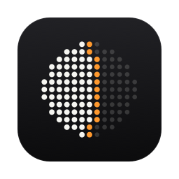
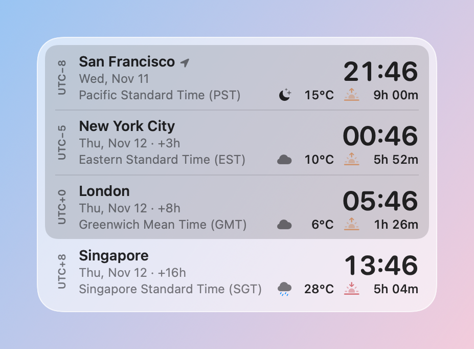

# Better World Clock

A better world clock for the macOS desktop and menu bar, for keeping track of several time zones at a glance.

**Website:** [mxshell.dev/BetterWorldClock](https://mxshell.dev/BetterWorldClock/)

<picture>
  <source media="(prefers-color-scheme: dark)" srcset="docs/preview-dark.png">
  
</picture>

## Features

- **2–10 cities**, sorted west to east by UTC offset, with the offset running down the left edge.
- The **time** there (24- or 12-hour), the **weekday and date**, and how far ahead or behind you it is.
- The **time zone name** with its abbreviation, such as Pacific Standard Time (PST), and a **DST** badge while daylight saving time is on.
- **Current weather** and temperature, in °C or °F.
- A **countdown to the next sunrise or sunset**. Cities where it's night are shaded, and neighbouring night rows join into one band.
- A **UTC** row whenever none of your cities is on UTC+0.
- Two places to see it: a Liquid Glass **desktop widget** that sits behind your windows on every Space, and a dotted **globe** in the menu bar that drops down the same panel. The widget can be turned off.
- Starts at login, and keeps itself up to date.

## Install

1. Download the latest **BetterWorldClock-….dmg** from [Releases](https://github.com/mxshell/BetterWorldClock/releases/latest).
2. Open it and drag **World Clock+** onto **Applications**.
3. Open World Clock+ from Applications.

It needs macOS 26 or later, on Apple silicon or Intel, and it's signed and notarized by Apple. The app is called **World Clock+** because "Better World Clock" is too long to show in full under an app icon.

## Updates

World Clock+ checks for a new version once a day. When there is one, the menu bar panel says so: click **Update**, and the app installs it and reopens. Your cities and settings carry over. You can also check from **Settings › Updates**, or turn the daily check off there.

Versions before 1.2.0 don't update themselves. To get 1.2.0, download it and replace the app in Applications; after that, updates come to you.

## Using it

- **Desktop widget:** drag it anywhere. It remembers the spot, and grows downward from its top-left corner as you add cities.
- **Menu bar:** click the globe to see the clocks over any window. ⌘-drag it to move it.
- **Right-click** the widget or the panel for quick options: show or hide the widget, weather, and sunrise and sunset; the time format; and the temperature unit.
- **Settings…** (in either menu, or open the app again from Finder or Spotlight): search for cities to add, remove cities, and change the same options, plus launch at login.

## Privacy

Better World Clock has no accounts, analytics or tracking, and your cities and settings stay on your Mac. It contacts:

- [Open-Meteo](https://open-meteo.com)'s forecast API, which receives the coordinates of your cities, about every 2 hours;
- Open-Meteo's geocoding API, which receives what you type into the city search;
- GitHub, once a day, to see whether there's a new version (you can turn this off), and to download it when you update.

Sunrise and sunset times are calculated on your Mac.

## Credits

Weather data by [Open-Meteo.com](https://open-meteo.com/), licensed under [CC BY 4.0](https://creativecommons.org/licenses/by/4.0/).

## Building it yourself

Building from source, how the app works, and how releases are made are covered in [DEVELOPMENT.md](DEVELOPMENT.md).

## License

MIT. See [LICENSE](LICENSE).
